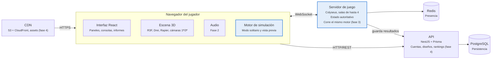

# Arquitectura

Documenta lo que **existe hoy** (fases 0 y 1) y lo que se **prevé** (fases 3 y 4). Decisiones de
fondo: `docs/adr/`. Estado: `docs/STATUS.md`.

## Vista general

Hoy todo corre en el navegador: el cliente importa el motor de `@payload/shared` y simula en local.
El diseño objetivo (plan original, `docs/plan-original/plan-juego-misiones-espaciales.md`) añade un
servidor de juego autoritativo que corre **el mismo motor**, y una API con persistencia.



Existe hoy: `UI`, `ESC` y `SIM1` (fase 1). `AUD`, `CDN`, `GS`, `API`, `RED` y `PG` son diseño futuro.

## Paquetes y dependencias

Workspaces: `apps/*` y `packages/*` (`pnpm-workspace.yaml`). Turborepo orquesta `build`, `test`,
`typecheck` y `dev` (`turbo.json`). `pnpm validate` = `turbo run typecheck test build`.

| Paquete | Estado | Dependencias principales (package.json) |
| --- | --- | --- |
| `@payload/shared` | Fase 1 | `zod ^4.6.7`. Dev: `vitest ^5.1.0`, `tsx ^4.23.15`, `exceljs ^4.4.0` (hoja de cálculo), `@types/node ^24`. Exporta `./src/index.ts` y `./catalog/*` |
| `@payload/client` | Fase 1 | `@payload/shared workspace:*`, `react`/`react-dom ^19.3.1`, `three ^0.187.0`, `@react-three/fiber ^9.8.2`, `drei ^10.7.9`, `rapier ^2.2.0`, `postprocessing ^3.2.2` (declarada, aún sin uso), `zustand ^5.1.0`, `xstate ^5.33.4`, `@xstate/react ^6.1.0`, `i18next ^27.0.1`, `react-i18next ^18.0.0`, `i18next-browser-languagedetector ^8.3.0`, `lucide-react ^1.70.0`. Dev: `vite ^8.3.6`, `@vitejs/plugin-react ^6.2.1`, `tailwindcss` y `@tailwindcss/vite ^4.3.5`, `vitest ^5.1.0` |
| `@payload/game-server` | Marcador (fase 3) | Ninguna; scripts `echo` |
| `@payload/api` | Marcador (fase 4) | Ninguna; scripts `echo` |
| raíz | | `turbo ^2.11.10`, `typescript ~6.0.3`, `prettier ^3.9.10`, `@gltf-transform/cli ^4.5.1` |

Dependencias entre paquetes: `client -> shared`. `shared` no depende de nadie (regla: TS puro, sin
React, Three.js, DOM ni Node en `src/`; lo vigila `purity.test.ts`).

## `@payload/shared`: el motor

- **Contrato:** `src/types.ts`. Solo cambios aditivos; romperlo exige un ADR.
- **Catálogo:** `catalog/{componentes,orbitas,lanzadores,escenarios}.json` -> `parseCatalog` (zod) -> `catalog`. Añadir contenido no toca código.
- **API:** `computeBudgets`, `reviewGoNoGo`, `createMissionSim`/`runMission`, `scoreMission`, `buildReport`, `createRng`, `formatMessage` (lista completa en `packages/shared/CLAUDE.md`).

### Modelo de simulación (resumen)

- **Órbita** (`orbital.ts`): `a = R⊕ + (hp+ha)/2`, `T = 2π√(a³/μ)` con μ = 398 600 km³/s². Eclipse con β = 0 (peor caso): `f = asin(R⊕/(R⊕+h))/π`. Contacto por estación con elevación mínima de 10°: `1440 · (1 − cos λ)/2 · 2` min/día, `λ = acos(R⊕ cos ε/(R⊕+h)) − ε`. GEO = 1440 min.
- **Presupuestos** (`budgets.ts`): `used/available` por recurso; `tight` si el margen < 15 %, `over` si se excede. Tiempo = pieza más lenta + 0,25 meses por pieza + espera del lanzador. Vida = min(arrastre, `5 · ln 0.7 / ln(R^(1+2·rad))`). Operación = `operationsCostMUSDPerYear × minLifetimeYears`.
- **Go/No-Go** (`review.ts`): `go = false` si hay algún `blocker`. Los requisitos del escenario y `power-storm` son avisos.
- **Simulación** (`simulation.ts`, `constants.ts`): **paso fijo de 30 s**; `step(dt)` acumula tiempo y ejecuta los pasos fijos que quepan, así que el resultado no depende de cómo se trocee. Fase orbital uniforme, eclipse centrado en la fase 0,5. Batería: desgaste de −6 % de la capacidad nominal por hora bajo la DoD; al agotarse, apagón, modo seguro y −10 %; falla bajo el 60 % de la nominal o tras 5 agotamientos. Datos: se llenan por instrumentos y se bajan en contactos regulares. Eventos pre-sorteados por día según dificultad (tormenta solar −40 % de generación 8 h, falla de rueda de reacción, basura espacial con instrumentos apagados 2 h).
- **Semillas:** toda aleatoriedad pasa por `createRng(seed)`; prohibidos `Math.random()` y `Date.now()` en `src/`. La semilla por defecto del escenario es `20260101`; el cliente usa **una semilla por intento**: `defaultSeed + nº de intento` (el intento 0 es `defaultSeed`; "Rediseñar" lo incrementa).
- **Puntuación** (`scoring.ts`): `S = w1·objetivos + w2·ciencia + w3·eficiencia + w4·colaboración`, pesos por escenario. Objetivos = `100 · media · √mín` de los criterios con criterio de viabilidad.
- **Informe** (`report.ts`): `ReportEntry[]` con cadena de causas, todo como `MessageRef`.

## `@payload/client`: flujo de datos

```text
missionMachine (XState)  ── fase activa ──▶  App.tsx ── lazyScene ──▶ MenuScene | HangarScene | LaunchScene | OrbitScene
        ▲  eventos (PLAY, REQUEST_REVIEW, LAUNCH…)                         │ leen / escriben
        │                                                                   ▼
   UI (Screens, Huds, DesignPanel)  ◀── suscripción ──  stores Zustand: design · sim · settings · ui · launch
                                                                            │
                                                         @payload/shared: computeBudgets, reviewGoNoGo, createMissionSim
```

1. **Fases:** `app/missionMachine.ts` (XState v5) decide la fase: `menu -> briefing -> design -> review -> launch -> operation -> report`. Un No-Go (`isGo` falso) o `BACK_TO_DESIGN` vuelve a `design`; `REDESIGN` desde el informe incrementa el intento. Los datos no viven en la máquina.
2. **Estado:** stores Zustand (`state/`): `design` (diseño y objeto en mano, intento), `sim` (la `MissionSim`, snapshot vivo, eventos, resultado, aceleración `TIME_SCALES = [0,1,10,100,1000,10000]`), `settings` (persistido en `localStorage`), `ui` (overlay, vista 1ª/3ª, avisos) y `launch`.
3. **Escenas:** cada `Canvas` se carga con `React.lazy`. En operación cada frame llama `useSim.getState().tick(dt)` -> `sim.step(dt * aceleración)`; el snapshot "vivo" se lee con `getLiveSnapshot()` sin re-render y React solo se actualiza a ~10 Hz o con eventos.
4. **Mensajes del motor:** el motor devuelve `MessageRef { key, params }`. El cliente hace `i18n.t(ref.key, { ns: 'sim', ...ref.params })` (`tr()` en `i18n/index.ts`). Los params `component`, `structure`, `launcher` y `orbit` llevan **ids del catálogo**; las plantillas los muestran con `$t(catalog.{{component}})`, y `simLocales` genera el subárbol `catalog.<id>` desde los JSON. Los nombres del catálogo en la UI usan `lt(localizedText)`.

### i18n

| Namespace | Origen | Uso |
| --- | --- | --- |
| `ui` | `apps/client/src/locales/{es,en}.json` | Textos de la interfaz: `t('clave')` |
| `sim` | `packages/shared/locales/{es,en}.json` + `catalog.<id>` generado | Textos del motor: `tr(messageRef)` |

Las claves se aplanan al cargar (`keySeparator: false`, `nsSeparator: false`). Español por defecto: solo
se lee el idioma guardado por el usuario (`payload.lang`), no el del navegador. Tests de paridad es/en en ambos paquetes.

### Assets

- `assets/models/source/`: originales, intocables y versionados. `assets/web/models/`: optimizados con meshopt (`.claude/skills/3d-models/scripts/optimize.sh`), mismo nombre.
- Vite usa `publicDir: '../../assets/web'`, de modo que `assets/web/models/x.glb` se sirve como `/models/x.glb` (`src/models/urls.ts`).
- **Carga diferida:** el hangar carga el astronauta y, tras 2,5 s, el mecha (3,1 MB); el menú carga solo la galaxia; la escena orbital carga galaxia y, tras 3 s, ERIZON (7,1 MB). Un GLB ausente muestra una forma de respaldo (`ModelBoundary`). Peso total servido: ~11,9 MB.
- Licencias en `assets/CREDITS.md` y `src/data/credits.ts` (pantalla de créditos).

## Testing

| Suite | Archivos | Qué cubre |
| --- | --- | --- |
| `@payload/shared` (140 tests) | `orbital` | Kepler, eclipse, contacto (LEO a 400 km ≈ 92,6 min con tolerancia) |
| | `budgets`, `review` | Presupuestos, estados, diseños parciales, bloqueadores y avisos |
| | `simulation` | Determinismo (mismo resultado al trocear `step`), modelo de batería, datos y eventos |
| | `scoring` | Puntuación e informe con cadena de causas |
| | `catalog`, `balance` | Esquema zod, referencias, errores legibles; >= 2 diseños válidos y fallos por >= 4 causas |
| | `locales` | Paridad es/en y que toda `MessageRef` emitida existe y se resuelve |
| | `purity`, `rng` | Sin Node/DOM/React/relojes/azar global en `src/`; generador de semillas |
| `@payload/client` (9 tests) | `i18n` | Paridad de claves del namespace `ui` |
| | `flow` | Transiciones de la máquina XState e integración con el motor |
| | `fixes` | Semilla por intento, ayuda y textos, registro de eventos |

Rendimiento fino fuera de los tests: `pnpm --filter @payload/shared bench`. No hay tests E2E ni de
renderizado 3D (previstos para la fase 4, con Playwright).

## Cómo encajarán `game-server` y `api`

- **`apps/game-server` (fase 3):** Colyseus con `MissionRoom` (hasta 4 jugadores). Mantiene el diseño en un esquema sincronizado y **ejecuta el mismo motor** (`@payload/shared`): los clientes solo envían acciones (agregar instrumento, votar Go) y el servidor valida, recalcula `computeBudgets` y simula con una semilla. Test clave: una sala produce el mismo `MissionResult` que `runMission` con igual diseño y semilla. Por eso el motor no puede depender del DOM ni de Node. En el cliente habrá una capa con la misma interfaz para alternar motor local (solitario) y servidor (sala).
- **`apps/api` (fase 4):** NestJS + Prisma + PostgreSQL: cuentas, diseños guardados, rankings por escenario e informes. Reutiliza los tipos de `@payload/shared` (`MissionDesign`, `MissionResult`, `ScoreBreakdown`); el servidor de juego le envía resultados. Un ranking solo es fiable si el servidor recalcula la puntuación con el motor.
- Ambos deben importar de `@payload/shared` y no duplicar tipos ni fórmulas. Si el contrato necesita cambios, solo aditivos (o ADR).
