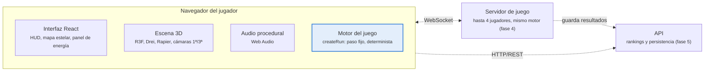

# Arquitectura

Documenta lo que **existe hoy** (fase 1 del juego nuevo) y lo que se **prevé** (fases 2-5). Decisiones de
fondo: `docs/adr/`. Estado: `docs/STATUS.md`. Diseño del juego: `docs/GDD.md`.

## Vista general

Hoy todo corre en el navegador: el cliente importa el motor de `@payload/shared` y simula la partida en
local. En la fase 4, un servidor autoritativo correrá **el mismo motor** y los clientes solo le enviarán
acciones (ADR 0009). La fase 5 añade una API con persistencia.



Existe hoy: `UI`, `ESC`, `AUD` y `SIM1`. `GS` y `API` son marcadores.

## Paquetes y dependencias

Workspaces: `apps/*` y `packages/*` (`pnpm-workspace.yaml`). Turborepo orquesta `build`, `test`,
`typecheck` y `dev` (`turbo.json`). `pnpm validate` = `turbo run typecheck test build`.

| Paquete | Estado | Dependencias principales |
| --- | --- | --- |
| `@payload/shared` | Fase 1 | `zod`. Dev: `vitest`, `tsx`, `@types/node`. Exporta `./src/index.ts` y `./catalog/*` |
| `@payload/client` | Fase 1 | `@payload/shared`, `react`/`react-dom` 19, `three`, `@react-three/fiber` 9, `drei`, `rapier`, `zustand`, `i18next`, `react-i18next`, `lucide-react`. Dev: `vite`, `tailwindcss` 4, `vitest` |
| `@payload/game-server` | Marcador (fase 4) | Ninguna; scripts `echo` |
| `@payload/api` | Marcador (fase 5) | Ninguna; scripts `echo` |
| raíz | | `turbo`, `typescript`, `prettier`, `@gltf-transform/cli` |

Dependencias entre paquetes: `client -> shared`. `shared` no depende de nadie (TS puro, sin React,
Three.js, DOM ni Node en `src/`; lo vigilan `tsconfig.json` sin tipos de Node y `purity.test.ts`).

## `@payload/shared`: el motor

- **Contrato:** `src/types.ts`. Solo cambios aditivos; romperlo exige un ADR.
- **Catálogo:** `catalog/{naves,averias,destinos,sectores}.json` → `parseCatalog` (zod) → `catalog`.
- **Módulos (`src/`):** `types` (contrato), `catalog` (esquema y búsquedas), `galaxy` (generador de
  sectores), `run` (la partida), `rng` (`createRng`, `deriveSeed`), `messages`/`locales` (i18n `sim`).
- **API:** `createRun`, `generateSector`, `isSectorSolvable`, `computeScore`, `fuelPerLy`,
  `cruiseSpeedLyPerS`, `formatMessage` (lista completa en `packages/shared/CLAUDE.md`).

### Modelo de la partida (`run.ts`)

```text
createRun({ seed })  ──▶  Run { state, step(dt), apply(action), takeEvents(), estimateJump(id), snapshot() }

  step(dt): acumula tiempo real y ejecuta pasos fijos de 0,1 s
     averías activas → casco / sistemas / oxígeno
     sobrecarga      → daño al reactor
     tránsito        → desgaste, avance, combustible, peligros pre-sorteados del salto, llegada
     derivados       → cortos, energía, sistemas en línea, velocidad, avisos de impacto
     permadeath      → casco 0 · oxígeno 0 · varada

  apply(action): jump · set-throttle · toggle-system · work-incident · repair-system · evade · service · next-sector
     devuelve { ok } o { ok: false, reason: MessageRef }
```

- **Determinismo:** misma semilla y mismas acciones en los mismos instantes dan la misma partida, sin
  importar cómo se trocee `step()` (hay test). El azar tiene tres flujos derivados con `deriveSeed`:
  generación del sector, peligros de cada salto (se sortean al iniciarlo, por posición en el trayecto) y
  desgaste (tres tiradas fijas por paso).
- **Fases:** `docked` (atracada; el tiempo corre y las averías siguen) → `transit` → `docked`… hasta el
  portal (`won`, tiempo detenido) → `next-sector`; o `lost` en cualquier momento.
- **Energía:** potencia = reactor × salud; demanda = sistemas encendidos (los motores solo consumen en
  tránsito y según el régimen). Demanda > potencia ⇒ sobrecarga, que daña el reactor.
- **Sector (`galaxy.ts`):** columnas de destinos entre la estación de salida y el portal, enlazados con
  la columna siguiente. `isSectorSolvable` comprueba por programación dinámica que hay una ruta hacia
  delante a régimen económico; el generador reintenta con semillas derivadas hasta lograrlo.
- **Mensajes:** `RunEvent.message` y los rechazos son `MessageRef`. Las plantillas anidan nombres con
  `$t(system.{{system}})`; `simLocales` añade `catalog.<id>` con los nombres del catálogo.

## `@payload/client`: flujo de datos

```text
App.tsx ── pantalla ──▶ MenuScene | ShipScene (lazy)
                                     │ cada frame
                                     ▼
   GameLoop (ShipScene) ── tick(dt) ──▶ game/runStore ── run.step / run.apply ──▶ @payload/shared
        │  puesto cercano + teclas             │ eventos → avisos (toasts), sonido (cue), sacudida
        ▼                                      ▼
   game/interaction (puro)             hud: copia del estado a ~10 Hz ──▶ Hud · StarMap · PowerPanel · EndScreen
   game/layout (puro)                  getRun().state: estado vivo ──▶ escena 3D (sin re-render)
```

1. **Partida:** `game/runStore.ts` (Zustand) crea la `Run`, la avanza con el tiempo real y reparte sus
   eventos. La escena lee `getRun().state` por frame; React recibe `hud` (copia) a ~10 Hz o con eventos.
2. **Interacción:** `game/layout.ts` dice dónde está cada puesto; `game/interaction.ts` decide qué hace
   la tecla E/Q junto al puesto más cercano y qué `RunAction` se envía. Ambos son lógica pura con tests.
3. **Escena:** `ShipScene` (bucle y teclas), `ShipInterior` (casco y colisiones), `ShipStations` (los
   ocho puestos), `ShipFx` (luces de alarma, fuego/chispas/gas, carteles), `SpaceView` y `SpaceBodies`
   (cielo, estrella, estelas y el destino por la proa). Todo el aspecto es procedural y vive en `gfx/`:
   texturas de canvas, materiales compartidos, shaders y un constructor que fusiona las piezas de cada
   modelo en una malla por material. Los únicos GLB son los de `assets/` (tripulante, consola, galaxia, estación).
4. **Estado de interfaz:** `state/ui.ts` (panel abierto, vista 1ª/3ª, aviso de acción) y
   `state/settings.ts` (persistido). `pause`, `settings` y `credits` detienen el tiempo; el mapa y el
   panel de energía no.
5. **Audio:** `audio/` procedural con Web Audio. Todo sonido pasa por `cue(id)`, que además deja un
   destello y un subtítulo; la música se mezcla según el peligro (`musicLogic.dangerLevel`).

### i18n

| Namespace | Origen | Uso |
| --- | --- | --- |
| `ui` | `apps/client/src/locales/{es,en}.json` | Textos de la interfaz: `t('clave')` |
| `sim` | `packages/shared/locales/{es,en}.json` + `catalog.<id>` generado | Textos del motor: `tr(messageRef)` o `t('systemName.x', { ns: 'sim' })` |

Las claves se aplanan al cargar (`keySeparator: false`, `nsSeparator: false`). Español por defecto: solo
se lee el idioma guardado por el usuario (`payload.lang`). Tests de paridad es/en en ambos paquetes; el
del cliente comprueba además que toda clave literal usada en el código existe.

### Assets

- `assets/models/source/`: originales, intocables. `assets/web/models/`: optimizados con meshopt
  (`.claude/skills/3d-models/scripts/optimize.sh`), mismo nombre.
- Vite usa `publicDir: '../../assets/web'`: `assets/web/models/x.glb` se sirve como `/models/x.glb`.
- En uso: astronauta (tripulante), consola (timón), galaxia (menú y holograma) y ERIZON (estación, con
  carga diferida). El mecha Aurora G9 se sirve pero no se usa hasta la fase 2. Un GLB ausente muestra una
  forma de respaldo (`ModelBoundary`).

## Testing

| Suite | Archivo | Qué cubre |
| --- | --- | --- |
| `@payload/shared` | `galaxy` | Catálogo válido y rechazos; sectores deterministas, enlazados y completables (200 semillas × 5 sectores) |
| | `run` | Determinismo al trocear `step`; viaje y combustible; energía y sobrecarga; averías; impactos; estaciones, portal y derrotas |
| | `locales` | Paridad es/en, params, longitud máxima y que toda `MessageRef` emitida existe y se resuelve |
| | `balance` | Con tripulante simulado (`bot.ts`): se gana jugando bien, se pierde sin hacer nada, la dificultad sube |
| | `purity`, `rng` | Sin Node/DOM/React/relojes/azar global en `src/`; generador de semillas |
| `@payload/client` | `game` | Distribución de la nave, interacciones, almacén de la partida (salto completo, pausa, derrota), panel de energía, audio |
| | `i18n` | Paridad de claves, claves usadas en el código, claves dinámicas, longitud |

No hay tests de renderizado 3D ni E2E (fase 5). La escena se comprueba a mano en el navegador.

## Fases siguientes

- **Fase 2 (superficie):** fases nuevas en `RunPhase` (aditivo), mundos en el catálogo, escena de
  superficie y jetpack en el controlador del jugador.
- **Fase 3 (economía):** mejoras como cambios sobre `ShipDef`; mercado en las estaciones.
- **Fase 4 (cooperativo):** `apps/game-server` corre `createRun` y aplica las `RunAction` de cada
  cliente; el cliente gana una capa de sesión local/sala. Base: ADR 0009 y 0010.
- **Fase 5:** `apps/api`, rankings recalculados por el servidor, despliegue.
