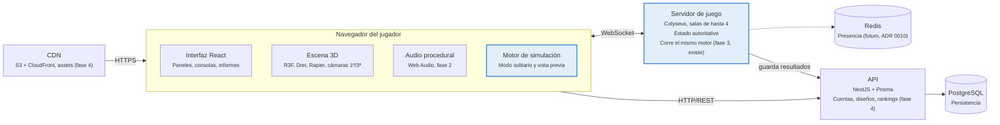

# Arquitectura

Documenta lo que **existe hoy** (fases 0 a 3) y lo que se **prevé** (fase 4). Decisiones de
fondo: `docs/adr/`. Estado: `docs/STATUS.md`. Contrato del multijugador: `docs/MULTIPLAYER.md`.

## Vista general

En solitario todo corre en el navegador: el cliente importa el motor de `@payload/shared` y simula en local.
En equipo (fase 3), un servidor de juego autoritativo (`apps/game-server`, Colyseus) corre **el mismo motor**
y los clientes solo le envían acciones. El diseño objetivo (plan original, `docs/plan-original/plan-juego-misiones-espaciales.md`)
añade además una API con persistencia (fase 4) y Redis cuando haya varias instancias del servidor (ADR 0010).



Existe hoy: `UI`, `ESC`, `SIM1` (fase 1), `AUD` (fase 2) y `GS` (fase 3, un solo proceso). `CDN`, `API`, `RED` y `PG` son diseño futuro (fase 4).

## Paquetes y dependencias

Workspaces: `apps/*` y `packages/*` (`pnpm-workspace.yaml`). Turborepo orquesta `build`, `test`,
`typecheck` y `dev` (`turbo.json`). `pnpm validate` = `turbo run typecheck test build`.

| Paquete | Estado | Dependencias principales (package.json) |
| --- | --- | --- |
| `@payload/shared` | Fase 3 | `zod ^4.6.7`. Dev: `vitest ^5.1.0`, `tsx ^4.23.15`, `exceljs ^4.4.0` (hoja de cálculo), `@types/node ^24`. Exporta `./src/index.ts` y `./catalog/*` |
| `@payload/client` | Fase 3 | `@payload/shared workspace:*`, `@colyseus/sdk 0.18.9` (carga diferida), `react`/`react-dom ^19.3.1`, `three ^0.187.0`, `@react-three/fiber ^9.8.2`, `drei ^10.7.9`, `rapier ^2.2.0`, `postprocessing ^3.2.2` (declarada, aún sin uso), `zustand ^5.1.0`, `xstate ^5.33.4`, `@xstate/react ^6.1.0`, `i18next ^27.0.1`, `react-i18next ^18.0.0`, `i18next-browser-languagedetector ^8.3.0`, `lucide-react ^1.70.0`. Dev: `vite ^8.3.6`, `@vitejs/plugin-react ^6.2.1`, `tailwindcss` y `@tailwindcss/vite ^4.3.5`, `vitest ^5.1.0` |
| `@payload/game-server` | Fase 3 | `@payload/shared workspace:*`, `@colyseus/core 0.18.27`, `@colyseus/ws-transport 0.18.4`, `@colyseus/schema 5.0.45`. Dev: `@colyseus/sdk 0.18.9`, `vitest`, `tsx`, `esbuild`, `typescript`, `@types/node` |
| `@payload/api` | Marcador (fase 4) | Ninguna; scripts `echo` |
| raíz | | `turbo ^2.11.10`, `typescript ~6.0.3`, `prettier ^3.9.10`, `@gltf-transform/cli ^4.5.1` |

Dependencias entre paquetes: `client -> shared`, `game-server -> shared` (el cliente solo usa el servidor por red; `room-e2e.test.ts` importa `apps/game-server/src/server.ts` por ruta relativa, sin declararlo como dependencia). `pnpm-workspace.yaml` fija `allowBuilds.msgpackr-extract: false` (se usa la versión JS del acelerador opcional de msgpackr). `shared` no depende de nadie (regla: TS puro, sin
React, Three.js, DOM ni Node en `src/`; lo vigila `purity.test.ts`).

## `@payload/shared`: el motor

- **Contrato:** `src/types.ts`. Solo cambios aditivos; romperlo exige un ADR.
- **Catálogo:** `catalog/{componentes,orbitas,lanzadores,escenarios}.json` + `{glosario,mascota,academia}.json` (estos tres opcionales en `Catalog`) -> `parseCatalog` (zod) -> `catalog`. Añadir contenido no toca código.
- **Módulos (`src/`):** `orbital` (Kepler), `budgets`, `review`, `simulation` + `constants`, **`events`** (tablas por dificultad, `rollPreLaunchEvents`, falla de componente/rueda; ADR 0008), `scoring`, `report`, **`advisors`** (`adviseByRole`: 4 roles), **`pedagogy`** (mascota, glosario, `evaluateAcademyStep`), `analysis`, `messages`/`locales` (i18n `sim`), `rng` (`createRng`, `deriveSeed`), `catalog`, `types` (contrato), y de la fase 3 **`team`** (roles, permisos, solicitudes, reparto de presupuesto, votos, alertas, colaboración) y **`teamWire`** (`RoomView`/`RoomStateWire`, `encodeRoomView`/`decodeRoomView`, `teamActionSchema`).
- **API:** `computeBudgets`, `reviewGoNoGo`, `createMissionSim`/`runMission`, `scoreMission`, `buildReport`, `createRng`, `formatMessage` (lista completa en `packages/shared/CLAUDE.md`).

### Modelo de simulación (resumen)

- **Órbita** (`orbital.ts`): `a = R⊕ + (hp+ha)/2`, `T = 2π√(a³/μ)` con μ = 398 600 km³/s². Eclipse con β = 0 (peor caso): `f = asin(R⊕/(R⊕+h))/π`. Contacto por estación con elevación mínima de 10°: `1440 · (1 − cos λ)/2 · 2` min/día, `λ = acos(R⊕ cos ε/(R⊕+h)) − ε`. GEO = 1440 min.
- **Presupuestos** (`budgets.ts`): `used/available` por recurso; `tight` si el margen < 15 %, `over` si se excede. Tiempo = pieza más lenta + 0,25 meses por pieza + espera del lanzador. Vida = min(arrastre, `5 · ln 0.7 / ln(R^(1+2·rad))`). Operación = `operationsCostMUSDPerYear × minLifetimeYears`.
- **Go/No-Go** (`review.ts`): `go = false` si hay algún `blocker`. Los requisitos del escenario y `power-storm` son avisos.
- **Simulación** (`simulation.ts`, `constants.ts`): **paso fijo de 30 s**; `step(dt)` acumula tiempo y ejecuta los pasos fijos que quepan, así que el resultado no depende de cómo se trocee. Fase orbital de Kepler (`orbitPhase` = anomalía verdadera / 2π; el tiempo de eclipse, contactos y energía sigue en anomalía media, eclipse centrado en la fase media 0,5). Batería: desgaste de −6 % de la capacidad nominal por hora bajo la DoD; al agotarse, apagón, modo seguro y −10 %; falla bajo el 60 % de la nominal o tras 5 agotamientos. Datos: se llenan por instrumentos y se bajan en contactos regulares. Eventos pre-sorteados según dificultad (`EVENT_TABLES` + `eventTuning` del escenario), en tres familias con flujos de azar separados (`deriveSeed`): entorno (tormenta solar −40 % de generación 8 h, basura espacial con instrumentos apagados 2 h, falla de rueda con apuntado de respaldo 1°/2°/5°), salud (sobrecalentamiento si el margen térmico < 15 %, falla de componente por fiabilidad × radiación; degradan, no destruyen) y pre-lanzamiento (`rollPreLaunchEvents`: retraso y recorte de presupuesto, que entran por `MissionSimOptions.preLaunch` y `computeBudgets(design, cat, preLaunch)`).
- **Semillas:** toda aleatoriedad pasa por `createRng(seed)`; prohibidos `Math.random()` y `Date.now()` en `src/`. La semilla por defecto del escenario es `20260101`; el cliente usa **una semilla por intento**: `defaultSeed + nº de intento`, con el intento persistido por escenario (`state/progress.ts`); cada partida nueva y "Rediseñar" lo incrementan.
- **Puntuación** (`scoring.ts`): `S = w1·objetivos + w2·ciencia + w3·eficiencia + w4·colaboración`, pesos por escenario. Objetivos = `100 · media · √mín` de los criterios con criterio de viabilidad, incl. agotamientos de batería (`energyCriterion`) y vida lineal 75 %→100 % (`lifetimeCriterion`).
- **Informe** (`report.ts`): `ReportEntry[]` con cadena de causas, todo como `MessageRef`.

## `@payload/client`: flujo de datos

```text
missionMachine (XState)  ── fase activa ──▶  App.tsx ── lazyScene ──▶ MenuScene | HangarScene | LaunchScene | OrbitScene | SurfaceScene
        ▲  eventos (PLAY, REQUEST_REVIEW, LAUNCH…)                         │ leen / escriben
        │                                                                   ▼
   UI (Screens, Huds, DesignPanel)  ◀── suscripción ──  stores Zustand: design · sim · settings · progress · ui · launch · mascot · academy · cues
                                                                            │
                                                         @payload/shared: computeBudgets, reviewGoNoGo, createMissionSim
```

1. **Fases:** `app/missionMachine.ts` (XState v5) decide la fase: `menu -> briefing -> design -> review -> prelaunch -> launch -> operation -> report`. Tras el Go, la acción `rollPreLaunch` llama a `rollPreLaunchEvents` y entra en `prelaunch` (`PreLaunchScreen`); si no hay eventos pasa directo a `launch`. Un No-Go (`isGo` falso) o `BACK_TO_DESIGN` vuelve a `design`; `REDESIGN` desde el informe incrementa el intento. Los datos no viven en la máquina.
2. **Estado:** stores Zustand (`state/`): `design` (diseño y objeto en mano, intento), `sim` (la `MissionSim`, snapshot vivo, eventos, resultado, aceleración `TIME_SCALES = [0,1,10,100,1000,10000]`), `settings` (persistido en `localStorage`), `ui` (overlay, vista 1ª/3ª, avisos) y `launch`.
3. **Escenas:** cada `Canvas` se carga con `React.lazy`. En operación cada frame llama `useSim.getState().tick(dt)` -> `sim.step(dt * aceleración)`; el snapshot "vivo" se lee con `getLiveSnapshot()` sin re-render y React solo se actualiza a ~10 Hz o con eventos.
4. **Mensajes del motor:** el motor devuelve `MessageRef { key, params }`. El cliente hace `i18n.t(ref.key, { ns: 'sim', ...ref.params })` (`tr()` en `i18n/index.ts`). Los params `component`, `structure`, `launcher` y `orbit` llevan **ids del catálogo**; las plantillas los muestran con `$t(catalog.{{component}})`, y `simLocales` genera el subárbol `catalog.<id>` desde los JSON. Los nombres del catálogo en la UI usan `lt(localizedText)`.

### Capas de la fase 3 en el cliente (`net/` y `room/`)

Contrato y reglas: `docs/MULTIPLAYER.md` y `apps/client/CLAUDE.md`.

- **`net/` — sesión única:** toda escritura de juego de la UI y las escenas pasa por `getSession()` (interfaz `MissionSession`). `LocalSession` (solitario) usa los stores y la máquina de siempre; `RoomSession` (sala Colyseus) envía `TeamAction` al servidor y **no aplica nada por su cuenta**: el estado de la sala (`decodeRoomView`) se escribe en `useDesign`, `useSim` y `useRoom`. Las escenas y paneles siguen leyendo los mismos stores. `useRoom` guarda la vista, los selectores y `canDo` (permisos con `checkTeamAction`, nunca reglas propias). El SDK de Colyseus se importa con `import()` diferido.
- **Espejo de la simulación:** en sala, `useSim.mirrorStart` crea la `MissionSim` con la semilla, el diseño y el `preLaunch` de la sala, y `tick` la avanza hacia `view.sim.simT` sin pasarlo nunca (si el snapshot local difiere del del servidor, avisa y se recrea; el `result` del informe es el del servidor). La mascota la decide el servidor (`view.mascot`).
- **`room/` — UI de sala:** entrada («Jugar en equipo»), lobby, `TeamBar`, paneles de chat, solicitudes, reparto de presupuesto, pings y alertas, votación con motivo y colaboración en el informe. Lógica pura en `roomUiLogic.ts` (testeada en node). `scenes/ControlRoomScene` (sala de control) y `scenes/RoomAvatars` (avatares y pings en el hangar).
- Limitación: el servidor no publica su reloj; el cliente lo estima (`useRoomClock`) para horas relativas y la cuenta atrás de las alertas.

### Módulos de la fase 2 en el cliente

Cada uno separa lógica pura (testeada en node) de componentes React; todo lee datos del catálogo.

| Carpeta | Qué hace |
| --- | --- |
| `src/mascot/` | Mascota por datos (`catalog.mascot`): disparadores `event:`, `resource-over:`, `phase:`, `help:`... -> diálogo (`pickMascotDialogue`); cola con enfriamiento 15 s, burbuja `aria-live`, avatar SVG o `sprite2d`. Desactivable |
| `src/academy/` | Pasos de `catalog.academy` evaluados con `evaluateAcademyStep`; bloquea la revisión hasta `step-go`; panel con objetivo y resaltado del recurso |
| `src/audio/` | Web Audio procedural: `musicLogic`/`soundLogic` (puros) -> `AudioEngine` (buses música/efectos/avisos, 5 capas, emisores 3D). Todo sonido pasa por `cue(id)` (suena + flash + subtítulo) |
| `src/instrument/` | Vista del instrumento (`I`): estado (eclipse / degradado / sin señal) derivado del snapshot y de los eventos; acceso a `SurfaceScene` |

### i18n

| Namespace | Origen | Uso |
| --- | --- | --- |
| `ui` | `apps/client/src/locales/{es,en}.json` | Textos de la interfaz: `t('clave')` |
| `sim` | `packages/shared/locales/{es,en}.json` + `catalog.<id>` generado | Textos del motor: `tr(messageRef)` |

Las claves se aplanan al cargar (`keySeparator: false`, `nsSeparator: false`). Español por defecto: solo
se lee el idioma guardado por el usuario (`payload.lang`), no el del navegador. Tests de paridad es/en en ambos paquetes.

### Assets

- `assets/models/source/`: originales, intocables y versionados. `assets/web/models/`: optimizados con meshopt (`.claude/skills/3d-models/scripts/optimize.sh`), mismo nombre.
- Vite usa `publicDir: '../../assets/web'`, de modo que `assets/web/models/x.glb` se sirve como `/models/x.glb` (`src/models/urls.ts`).
- **Carga diferida:** el hangar carga el astronauta y, tras 2,5 s, el mecha (3,1 MB); el menú carga solo la galaxia; la escena orbital carga galaxia y, tras 3 s, ERIZON (7,1 MB). Un GLB ausente muestra una forma de respaldo (`ModelBoundary`). Peso total servido: ~11,9 MB.
- Licencias en `assets/CREDITS.md` y `src/data/credits.ts` (pantalla de créditos).

## Testing

| Suite | Archivos | Qué cubre |
| --- | --- | --- |
| `@payload/shared` (335 tests, 18 archivos) | `orbital`, `kepler` | Kepler, eclipse, contacto (LEO a 400 km ≈ 92,6 min con tolerancia); fase de Kepler |
| | `budgets`, `review` | Presupuestos, estados, diseños parciales, bloqueadores y avisos |
| | `simulation`, `events` | Determinismo (mismo resultado al trocear `step`), batería, datos; eventos por dificultad y pre-lanzamiento |
| | `scoring`, `advisors`, `pedagogy` | Puntuación e informe; asesores por rol; mascota, glosario y Academia |
| | `catalog`, `balance`, `balance-review`, `scenarios` | Esquema zod, referencias; >= 2 diseños válidos y fallos por >= 4 causas; fixtures por escenario (>= 2 válidas y >= 2 causas de fallo en cada uno) |
| | `team`, `team-wire` | Roles, permisos, solicitudes (también encadenadas), reparto, votos, alertas, colaboración; ida y vuelta de `RoomView`; esquema zod de `TeamAction` |
| | `locales` | Paridad es/en y que toda `MessageRef` emitida (incluida la lógica de equipo) existe y se resuelve |
| | `purity`, `rng` | Sin Node/DOM/React/relojes/azar global en `src/`; generador de semillas |
| `@payload/client` (122 tests, 8 archivos) | `i18n` | Paridad de claves del namespace `ui` |
| | `flow`, `fixes` | Transiciones de la máquina XState e integración con el motor; semilla por intento, ayuda y textos |
| | `phase2`, `phase2b` | Academia, escenarios, mascota, glosario, Kepler; audio (sin `AudioContext` y simulado), capas de música, vista del instrumento, rover |

| | `net`, `room-ui` | `LocalSession`/`RoomSession` con sala simulada (permisos, espejo de la simulación, avisos, mascota, reconexión, errores); lógica de la UI de sala y botones → acción |
| | `room-e2e` | Servidor real de `apps/game-server` + la app + 3 clientes SDK: misión completa con paridad `runMission` (~7 s); 5.º jugador, entrada tras empezar y código inexistente |
| `@payload/game-server` (78 tests, 7 archivos) | `parity` | Todos los fixtures `valid`: el `MissionResult` de la sala es igual al de `runMission` |
| | `roomModel`, `mascot`, `options` | Fases, permisos, solicitudes, reparto, votos, alertas, rediseño, salidas, chat, pings; mascota única; opciones de creación |
| | `schema`, `abuse` | Deltas del esquema y caché; 40 msg/s durante 60 s con el estado < 300 KB |
| | `network` | Servidor real + clientes `@colyseus/sdk`: CORS, emparejamiento, 4 clientes, reconexión, No-Go |

Rendimiento fino fuera de los tests: `pnpm --filter @payload/shared bench`. No hay tests E2E ni de
renderizado 3D (previstos para la fase 4, con Playwright).

## `@payload/game-server`: servidor de juego (fase 3)

Colyseus 0.18 (`@colyseus/core` + `@colyseus/ws-transport`, schema 5) con la sala `mission`. Decisión: ADR 0009; presencia y escalado (un proceso, sin Redis): ADR 0010; guía del paquete: `apps/game-server/CLAUDE.md`.

**Estructura (`src/`):** `roomModel.ts` (modelo PURO de la sala: `RoomView` + `MissionSim`; `apply`, `tick`, `join/drop/reconnect/leave`; sin Colyseus ni reloj), `mascotDirector.ts`, `schema.ts` (esquema = `RoomStateWire` y `StateWriter` incremental), `MissionRoom.ts` (adaptador), `options.ts`, `server.ts` (`createGameServer`), `index.ts` (proceso real, `PORT` 2567).

**Flujo de una sala:**

```text
cliente ── action (TeamAction) ──▶ MissionRoom ──▶ RoomModel.apply(playerId, raw, nowS)
                                                    │  parseTeamAction → checkTeamAction (shared) → reviewGoNoGo / computeBudgets
                                                    ▼
                                        RoomView nueva ──▶ StateWriter ──▶ esquema Colyseus ──▶ parche a los clientes
cliente ◀── notice (rechazo, request-created, ping) ── después del parche
tick a 10 Hz: RoomModel.tick(dt, nowS) → sim.step(dt × accel) · alertas · mascota
```

Fases: `lobby → briefing → design → review → prelaunch → launch → operation → report` (la sala se bloquea al salir del lobby). Tras el Go: `rollPreLaunchEvents` y `createMissionSim(design, cat, { seed, preLaunch })`; el informe usa `sim.finish()`, de modo que el `MissionResult` es idéntico al de `runMission`. `teamScore = withCollaboration(result.score, scoreCollaboration(...).score)` va aparte.

**Esquema:** refleja `RoomStateWire` campo a campo (hay una comprobación de tipos que falla si el contrato gana un campo). Primitivos, `players` como mapa por `sessionId`, `componentIds` como array y el resto (solicitudes, votos, alertas, eventos, chat, `result`…) como cadenas JSON; los números no enteros en `float64`. `Encoder.BUFFER_SIZE` = 256 KB (el estado del informe pesa hasta ~200 KB).

**Límites** (`TEAM_LIMITS` + servidor): reconexión 60 s; alertas 45 s; pantalla de lanzamiento 25 s; 5 solicitudes abiertas por jugador y una cada 2 s; 40 piezas; chat 1 s, ping 2 s, `move` 10 Hz; 40 mensajes/s por cliente. Detalle en `docs/MULTIPLAYER.md` y `apps/game-server/README.md`.

## Cómo encajará `api` (fase 4)

- **`apps/api` (fase 4):** NestJS + Prisma + PostgreSQL: cuentas, diseños guardados, rankings por escenario e informes. Reutiliza los tipos de `@payload/shared` (`MissionDesign`, `MissionResult`, `ScoreBreakdown`); el servidor de juego le enviará resultados. Un ranking solo es fiable si el servidor recalcula la puntuación con el motor.
- **Escalado del servidor de juego:** Redis para presencia y driver cuando haya más de un proceso (ADR 0010).
- Todos deben importar de `@payload/shared` y no duplicar tipos ni fórmulas. Si el contrato necesita cambios, solo aditivos (o ADR).
