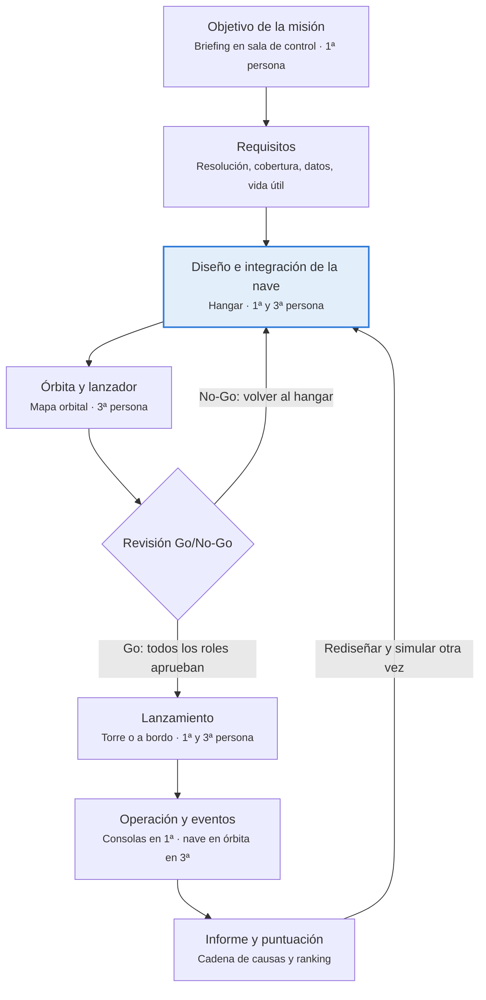
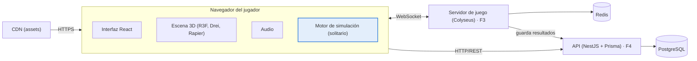

# Payload — Documento de diseño del juego (GDD)

> Versión de fase 0 · 7 de noviembre de 2026 · Basado en `docs/plan-original/plan-juego-misiones-espaciales.md`.
> **Payload** es el nombre definitivo (antes "Control de Misión", título de trabajo).
> Este documento describe diseño e intención; el estado real de la implementación está en `docs/STATUS.md`.

Leyenda de alcance: **[F1]** entra en la fase 1 (rebanada vertical en solitario) · **[F2]**, **[F3]**, **[F4]** fases posteriores. Ver el resumen en [§ 14](#14-alcance-por-fase).

## 1. Visión y pilares

**Visión.** Payload es un simulador 3D web, en TypeScript y React Three Fiber, donde de 1 a 4 jugadores diseñan, lanzan y operan una misión espacial completa, alternando entre primera y tercera persona. El jugador debe terminar entendiendo que **cada decisión mueve la masa, la energía, el presupuesto, los datos, las comunicaciones y la vida útil**.

**Pilares**

| Pilar | Qué significa | Cómo lo comprobamos |
| --- | --- | --- |
| Los compromisos son el juego | No hay una respuesta única: hay varias soluciones válidas y varias formas de fallar | El catálogo permite ≥ 2 diseños válidos y fallos por causas distintas (tests del motor) |
| Cada valor tiene su "¿por qué?" | Ningún número aparece sin explicación de 1-2 frases | Todo recurso del panel lleva un `MessageRef` explicativo |
| Se aprende iterando | El informe devuelve al diseño: rediseñar y volver a simular | Bucle Informe → Hangar siempre disponible |
| Corre en el navegador | Sin instalación; WebGL 2 de base | Meta de 60 FPS en una laptop de gama media |
| Bilingüe y accesible | Español por defecto, inglés completo; todo lo 3D tiene alternativa 2D | Test de paridad de claves es/en; modo de panel 2D |

**No es:** un simulador de vuelo con física real de maniobras, ni un juego de acción. El modelo orbital es deliberadamente simplificado (Kepler) con valores plausibles.

## 2. Público

Estudiantes y aspirantes a ingeniería, de nivel básico a avanzado, en español e inglés. El jugador elige idioma al iniciar y puede cambiarlo en Ajustes en cualquier momento. La dificultad (componentes básicos o avanzados, eventos, restricciones) ajusta la curva.

## 3. Bucle de juego

Una partida recorre ocho etapas; el informe lleva de vuelta al diseño.

Las fases del flujo en el contrato (`MissionPhase`) son: `briefing → design → review → launch → operation → report`. Un No-Go regresa al hangar sin lanzar y el informe explica qué falló y por qué. **[F1]** implementa el bucle completo en solitario.

## 4. Cámaras y controles

La primera persona se usa donde el jugador *hace*; la tercera, donde *observa*. Ambas comparten el controlador de personaje, así que cambiar de vista no cambia la física.

| Espacio | Primera persona | Tercera persona | Fase |
| --- | --- | --- | --- |
| Hangar / sala limpia | Caminar, tomar componentes de los estantes y encajarlos en la nave | Cámara sobre el hombro; vista libre alrededor de la nave | F1 |
| Sala de control | Sentarse en la consola y usar pantallas interactivas | Ver la sala y a los compañeros | F1 (consola básica) · F3 (equipo) |
| Plataforma de lanzamiento | Vista desde la torre o a bordo | Cámara de persecución, separación de etapas | F1 (cámara de persecución simple) |
| Órbita / operación | Vista "a través del instrumento" | Cámara orbital con la Tierra; mapa con traza de la órbita | F1 (3ª persona orbital) · F2 (vista del instrumento) |

**Controles**

- Teclado y ratón: `WASD` + ratón con *pointer lock*; `V` alterna primera/tercera persona; `E` interactuar; `Tab` panel de recursos; `H` ayuda de la mascota **[F2]**.
- Mando (Gamepad API) y táctil como soporte secundario **[F4]**.
- Transición suave entre vistas (0.3–0.5 s).

**Confort:** deslizador de FOV, balanceo de cabeza desactivable, giro por pasos. **Modo accesible:** todo lo que se hace en primera persona se puede hacer desde un panel 2D **[F1: panel de recursos y diseño 2D]**.

**Implementación prevista:** controlador cinemático de Rapier (`@react-three/rapier`); `PointerLockControls` y `KeyboardControls` de Drei en primera persona, `CameraControls` en tercera. *ecctrl* es una alternativa a evaluar.

## 5. Modos de juego y roles

| Modo | Jugadores | Qué aporta | Fase |
| --- | --- | --- | --- |
| Academia (tutorial) | 1 | Rise enseña cada recurso con una mini-misión (CubeSat en órbita baja) | F2 |
| Campaña de escenarios | 1–4 | Misiones con dificultad creciente | F1 (1 escenario) · F2 (5) |
| Cooperativo | 2–4 | Un equipo, una misión, cada quien con su rol | F3 |
| Competitivo | 2+ equipos | Mismo objetivo, gana la mejor puntuación | F4 |
| Sandbox | 1–4 | Sin presupuesto ni límites predefinidos | F4 |

| Rol | Decide sobre | Vigila |
| --- | --- | --- |
| Director/a de misión | Objetivo, requisitos, órbita, lanzador, aprobación final | Presupuesto, tiempo de desarrollo |
| Ingeniería de nave | Estructura, paneles, baterías, computadora, actitud, térmico | Masa, energía |
| Ciencia y carga útil | Instrumentos y plan de observación | Valor científico, datos generados |
| Operaciones y comunicaciones | Antenas, estaciones, contactos, respuesta a eventos | Enlace de datos, vida útil |

Con menos de cuatro jugadores los roles se combinan. **En solitario [F1]** el jugador asume los cuatro roles y, en fases siguientes, un asesor por rol (controlado por el juego) da recomendaciones **[F2]**.

**Colaboración [F3]:** solicitudes de recursos entre roles (p. ej. Ciencia pide +40 W; Ingeniería aprueba o propone otra solución), presupuestos asignados por subsistema, revisión Go/No-Go con voto por rol y motivo obligatorio del No-Go, eventos que exigen acción de varios roles, chat, *pings* y voz opcional (WebRTC). La puntuación incluye una parte de colaboración.

## 6. Mascota guía: Rise y plan B

Rise, la mascota lunar de Artemis II (peluche con forma de Luna sonriente y gorra azul y verde, diseñado por Lucas Ye para el concurso Moon Mascot de NASA y Freelancer), guía la Academia **[F2]**. En la misión real fue el indicador de gravedad cero, lo que encaja con el propósito educativo.

| Momento | Qué hace |
| --- | --- |
| Academia | Presenta cada recurso con una mini-misión y señala en 3D el componente o consola |
| Hangar y sala de control | Flota junto al jugador; con `H` da ayuda contextual |
| Panel de recursos | Muestra el "¿por qué?" y cambia de expresión cuando un recurso entra en rojo |
| Lanzamiento | Indicador de gravedad cero: flota al llegar a microgravedad, con ficha explicativa |
| Informe | Narra la cadena de causas y sugiere qué rediseñar |

Personalidad: expresiones (contenta, pensativa, preocupada, celebrando), frases cortas, nunca solo "correcto/incorrecto", voz y textos es/en con subtítulos, desactivable para jugadores avanzados. Diálogos en JSON por idioma, disparados por eventos del motor.

### Mascota

**Derechos de uso (paso obligatorio antes de publicar).** El diseño de Rise **no es de dominio público**: NASA tiene los derechos y puede permitir reproducciones si se siguen sus guías de mercancía.

- Acción: pedir autorización escrita a NASA antes de publicar el juego o presentarlo en un concurso; no sugerir respaldo de NASA. Esto no es asesoría legal: confirmar con quien organice el reto.
- **Plan B:** el sistema de mascota debe funcionar igual con una **mascota original propia**: se cambian el modelo, las animaciones y los diálogos sin tocar código. Por eso la mascota se diseña como un *paquete de datos* (modelo GLB, morph targets de expresiones, animaciones, diálogos en JSON, versión 2D) intercambiable.
- Hasta tener autorización, **no se incluye Rise en el repositorio**; en F2 se implementa primero con una mascota genérica propia.

## 7. Sistemas del juego

Todo descansa en un motor de simulación TypeScript puro, separado de los gráficos, que corre igual en el navegador (solitario) y en el servidor (multijugador, [F3]). Componentes, órbitas, lanzadores y escenarios viven en JSON validado con zod: agregar contenido no requiere tocar código.

### 7.1 Objetivo y requisitos

Tipos de misión (`MissionType`): observación de la Tierra, telecomunicaciones, telescopio espacial, exploración lunar y de Marte. Del objetivo salen requisitos medibles (`ScenarioRequirements`): resolución en suelo máxima, bajada mínima de datos por día, vida útil mínima, revisita máxima, valor científico mínimo. **[F1]** incluye un escenario de observación de la Tierra en LEO; los demás tipos llegan en F2.

### 7.2 Nave y carga útil

Subsistemas (`SubsystemId`): estructura, energía (paneles), baterías, comunicaciones, computadora de a bordo (obc), control de actitud (adcs), térmico e instrumentos (payload).

| Atributo de componente | Unidad | Nota |
| --- | --- | --- |
| Masa | kg | Suma contra capacidad del lanzador y de la estructura |
| Consumo | W | Medio en operación; paneles = 0 |
| Costo | M USD | Contra presupuesto del escenario |
| Datos | Mbit/día | Solo instrumentos |
| Valor científico | 0–100 | Solo instrumentos |
| Fiabilidad | 0–1 | Probabilidad de no fallar en vida nominal |
| Nivel | básico / avanzado | Según dificultad |
| Desarrollo | meses | Tiempo de integración |

Más atributos por subsistema (generación solar, capacidad y profundidad de descarga de batería, tasa de bajada, almacenamiento, masa soportada, precisión de apuntado, disipación térmica, resolución en suelo y apuntado requerido de instrumentos). La definición exacta es `ComponentDef` en `packages/shared/src/types.ts`.

### 7.3 Órbita y lanzador

Órbitas (`OrbitId`): LEO, SSO, MEO, GEO, HEO y TLI (transferencia lunar). Cada una cambia revisita, fracción de eclipse (afecta energía), minutos de contacto con estaciones, radiación y vida por arrastre. **[F1]**: solo LEO (y los lanzadores que llegan a ella); **[F2]**: las seis.

Cada lanzador tiene capacidad de carga **por órbita**, costo, fiabilidad y plazo. El juego valida que masa y órbita sean compatibles con el lanzador antes de permitir el Go.

**Modelo orbital (Kepler simplificado):**

$$
T = 2\pi \sqrt{\frac{a^{3}}{\mu}}, \qquad \mu_{\oplus} = 398\,600\ \text{km}^3/\text{s}^2, \qquad a = R_\oplus + h
$$

Con $R_\oplus = 6371$ km. De ahí salen, en el peor caso (beta = 0):

- Fracción de eclipse $\approx \dfrac{1}{\pi}\arcsin\!\left(\dfrac{R_\oplus}{R_\oplus + h}\right)$ y minutos de eclipse = $T \times$ fracción.
- Órbitas por día = $1440 / T_{min}$ y minutos de contacto por día con una estación.

Referencia: LEO a 400 km tiene $T \approx 92.6$ min (92.4 min con $R = 6371$) y ≈ 39 % del periodo en sombra.

### 7.4 Recursos (presupuestos de ingeniería)

Panel en tiempo real: cada recurso es una barra con **margen** `(disponible − usado) / disponible` y estado `ok` / `tight` / `over`; el recurso que más limita se marca en rojo.

| Recurso | Comparación | Qué se aprende |
| --- | --- | --- |
| Masa | total vs capacidad del lanzador y de la estructura | Cada kg cuesta |
| Energía | generación media (paneles × luz) vs consumo | Los paneles no generan en eclipse |
| Batería | consumo × minutos de eclipse vs capacidad útil (DoD) | La batería cubre el eclipse |
| Presupuesto | componentes + lanzamiento (+ operación) vs presupuesto | Costo total del ciclo |
| Datos | generados por día vs capacidad de bajada | Lo que no se baja se pierde |
| Comunicaciones | tasa × contactos × estaciones vs requerido | El enlace es un recurso |
| Tiempo | meses de desarrollo vs máximo | Calendario |
| Vida útil | requerida vs por arrastre/fiabilidad | La órbita limita la vida |

### 7.5 Simulación y eventos

- Avance acelerado (1× a 10 000×) y pausa; paso fijo interno, **determinista**: mismo diseño, catálogo y semilla → mismo resultado, sin importar cómo se trocee el avance.
- **[F1]**: lanzamiento (éxito/fallo por fiabilidad), eclipse/contacto, batería, almacenamiento y bajada de datos, fallas de componentes.
- **[F2]**: eventos aleatorios ponderados por dificultad: falla de rueda de reacción, tormenta solar, basura espacial (evasión), retraso de lanzamiento, recorte de presupuesto.
- La semilla permite comparar diseños de forma justa; el escenario trae una semilla por defecto.

### 7.6 Puntuación

$$
S = w_1 \cdot \text{objetivos} + w_2 \cdot \text{ciencia} + w_3 \cdot \text{eficiencia} + w_4 \cdot \text{colaboración}
$$

Cada componente es 0–100; los pesos `w` cambian por escenario. La eficiencia premia márgenes sanos (ni sobrado ni al límite). En solitario la colaboración tiene peso 0 o neutro. Rankings por escenario, guardar, compartir por enlace y comparar diseños lado a lado: **[F4]**.

### 7.7 Valor educativo

- Cada valor tiene un "¿por qué?" (1-2 frases, lenguaje sencillo). **[F1]**
- Informe post-misión con cadena de causas: "la batería se agotó en el eclipse **porque** el instrumento consume 60 W **y** la órbita pasa 35 min en sombra", con sugerencia de rediseño. **[F1]**
- Glosario y fichas presentadas por la mascota (altitud orbital, carga útil, tasa de datos, enlace). **[F2]**
- El motor devuelve claves i18n con parámetros (`MessageRef`), nunca texto final.

## 8. Arte y assets

Estilo: realista simplificado (*low-poly* limpio, buena iluminación) que se vea bien en laptops modestas. Formato único: **glTF/GLB** comprimido (meshopt vía gltf-transform; texturas KTX2 cuando convenga).

### 8.1 Modelos del proyecto

| Modelo | Archivo (`assets/models/source/`) | Uso en el juego | Autor | Licencia |
| --- | --- | --- | --- | --- |
| Astronauta | `astronaut_by_jungle_jim.glb` | **Avatar** del jugador (visible en 3ª persona y en el equipo [F3]) | Jungle Jim | CC-BY-4.0 |
| Aurora G9 Expedition Walker | `aurora_g9_expedition_walker_mech.glb` | **Exhibición en el hangar**; futuro vehículo de exploración (misiones lunar/Marte) | Jungle Jim | CC-BY-4.0 |
| Our Milky Way galaxy | `our_milky_way_galaxy.glb` | **Fondo del menú** y del espacio en la escena orbital | aditya299792 | CC-BY-4.0 |
| Programme ERIZON | `programme_erizon.glb` | **Estación espacial de fondo** en la escena orbital | nejenabinupa | **CC-BY-NC-ND-4.0** |

Fuentes en Sketchfab (URL completas en `assets/CREDITS.md`). Los tres CC-BY exigen atribución visible (pantalla de créditos); además, nada de esto implica respaldo de los autores.

> **Aviso ERIZON (CC-BY-NC-ND).** La licencia prohíbe **uso comercial** y **obras derivadas**. Consecuencias: (1) el juego no puede monetizarse mientras use este modelo; (2) no se puede modificar su geometría ni materiales: la **optimización técnica** (compresión/cuantización meshopt) es una zona gris que debe revisarse con quien organice el reto o con el autor, y si hay duda se sirve el original o se sustituye; (3) mantenerlo **aislado y fácil de retirar** (un solo componente de escena, sin dependencias de gameplay); (4) si el proyecto pasa a ser comercial, sustituirlo por un modelo propio o con licencia compatible. Esto no es asesoría legal.

Pesos de los originales: ERIZON ≈ 32 MB y Aurora G9 ≈ 23 MB, por lo que **requieren optimización** antes de servirse (ver ADR 0006).

### 8.2 Otros recursos

| Recurso | Fuente | Nota |
| --- | --- | --- |
| Naves, cohetes, estaciones adicionales | NASA 3D Resources (sin copyright; sin logotipos NASA) | Opcional |
| Componentes modulares con *sockets* | Modelado propio (Blender) | Paneles, antenas, instrumentos |
| Hangar y sala de control | Blender + kits CC0 | Interiores modulares |
| Tierra, Luna, Marte | Texturas públicas de NASA | Esfera con color, nubes, luces nocturnas |
| Iluminación | HDRI de Poly Haven (CC0) | Reflejos en metal |
| Interfaz | `Html` de Drei / render a textura; iconos Lucide | Consolas 3D muestran la misma UI que los paneles 2D |
| Tipografía | Space Grotesk, Inter, JetBrains Mono (OFL) | Estilo consola |

Regla: todo asset se registra en `assets/CREDITS.md` (autor, fuente, licencia). Solo CC0, dominio público, CC-BY (con atribución) o licencia comercial verificada; CC-NC/ND solo con la salvedad de arriba. **[F1]**: hangar con kit simple y componentes con geometría primitiva o modelos propios sencillos.

## 9. Audio

Web Audio API: sonido posicional (`PositionalAudio`) en hangar y sala de control, Howler.js para música e interfaz. **[F1]**: efectos mínimos de interfaz (clic, encaje, error) y ambiente del hangar. **[F2]**: música adaptativa por capas (diseño, lanzamiento, operación, crisis, éxito/fracaso), voces y efectos 3D completos.

Decisiones: **realismo educativo** (en el vacío no hay sonido; en 3ª persona exterior solo ambiente amortiguado y el tutorial lo explica); audio de NASA permitido siguiendo sus guías y sin sugerir respaldo; formatos Opus/WebM con respaldo AAC; ≈ −16 LUFS; canales separados música/efectos/voz; **subtítulos para toda voz y señal visual para toda alarma**.

## 10. Interfaz e idiomas

- UI 2D en React 19 + Tailwind + Radix/shadcn; consolas diegéticas con la misma UI.
- **Bilingüe desde el día 1** (ADR 0005): `es` por defecto, `en` completo. Namespaces `ui` (cliente) y `sim` (motor); contenido del catálogo en `LocalizedText`. Un test garantiza que ambos idiomas tienen las mismas claves.
- Tipografía y estilo de consola de control; unidades siempre visibles.

## 11. Accesibilidad

Modo de panel 2D equivalente a la primera persona; FOV ajustable, sin balanceo de cabeza, giro por pasos; subtítulos y señales visuales para alarmas; no depender solo del color (estado con texto/icono además de verde/ámbar/rojo); teclado completo en menús. Auditoría y mando/táctil: **[F4]**.

## 12. Stack técnico (resumen)

TypeScript en todo el monorepo (pnpm + Turborepo, ADR 0001); React Three Fiber v9 + Drei + Rapier (ADR 0002); Zustand y XState en el cliente; i18next; Vitest y Playwright; Colyseus [F3]; NestJS + Prisma + PostgreSQL + Redis [F4]; AWS y Sentry [F4]. Alternativa descartada: Babylon.js. Arquitectura: el motor en `packages/shared` corre en el navegador (solitario) y en el servidor autoritativo (multijugador); los clientes solo envían acciones.

## 13. Riesgos

| Riesgo | Mitigación |
| --- | --- |
| Alcance demasiado grande | Rebanada vertical primero; multijugador y modos extra después |
| Rendimiento en laptops y móviles | WebGL 2, LOD, assets optimizados (los originales pesan decenas de MB), calidad automática |
| Mareo en primera persona | FOV ajustable, sin balanceo, panel 2D |
| Desincronización multijugador | Servidor autoritativo con el mismo motor [F3] |
| Realismo vs diversión | Modelos simplificados; pruebas de juego en cada fase (prototipo en papel en la fase 0) |
| Licencias | Registro en `assets/CREDITS.md`; ERIZON es NC-ND; Rise requiere autorización de NASA |

## 14. Alcance por fase

| Fase | Entra | Hito de salida |
| --- | --- | --- |
| 0 · Preproducción | GDD, catálogo JSON inicial, prototipos en papel y hoja de cálculo | Los compromisos son divertidos en papel |
| **1 · Rebanada vertical en solitario** | Hangar 1ª/3ª persona (avatar astronauta, Aurora G9 de exhibición); **un** escenario de observación en **LEO**; panel de recursos con "¿por qué?"; motor con tests y semilla; revisión Go/No-Go; lanzamiento; operación acelerada con eclipses/contactos/datos; informe con cadena de causas; es/en; fondo Vía Láctea y estación ERIZON en la escena orbital | Una misión completa jugable de principio a fin |
| 2 · Contenido y aprendizaje | 5 escenarios, 6 órbitas, más lanzadores, eventos aleatorios, dificultad, Academia con mascota (Rise o propia), glosario, música adaptativa | Pruebas de juego con estudiantes |
| 3 · Multijugador | Colyseus, salas de 4, roles, solicitudes de recursos, Go/No-Go compartido, avatares, chat, voz opcional | Cuatro jugadores estables en una misión |
| 4 · Pulido y lanzamiento | Rendimiento, accesibilidad, rankings, guardar/comparar/compartir, sandbox y competitivo, AWS, Sentry, E2E, mando/táctil | Lanzamiento |

Fuera de la fase 1: multijugador, cuentas, rankings, mascota, música adaptativa, eventos aleatorios complejos, móviles. Si el objetivo es un hackatón, la entrega mínima es la fase 1 más una sala cooperativa básica de la fase 3.

## 15. Preguntas abiertas

Del plan original:

- ¿Hay fecha de entrega o es para un hackatón con jurado? Define cuánto del roadmap entra en la primera entrega. **Responsable: por definir.**
- ¿Cuántas personas desarrollan y quién cubre arte 3D y audio? **Responsable: por definir.**
- ¿Debe funcionar en móviles o basta con escritorio? **Responsable: por definir.**

Surgidas al preparar este GDD:

- ¿El proyecto será comercial? Condiciona el uso de `programme_erizon.glb` (CC-BY-NC-ND) y la mascota. **Responsable: por definir.**
- ¿Se obtendrá autorización de NASA para Rise o se parte directamente de una mascota propia? **Responsable: por definir.**
- ¿La optimización técnica (compresión) de ERIZON cuenta como obra derivada para el organizador? **Responsable: por definir.**
- ~~¿Cómo se trata el tiempo de operación en el presupuesto?~~ **Resuelta:** `ScenarioDef.operationsCostMUSDPerYear` (1 M USD/año si no se define) × `minLifetimeYears` se suma al presupuesto.
- ¿Quién y cuándo ejecuta la prueba en papel con personas reales (hito de la fase 0)? **Responsable: por definir.**
