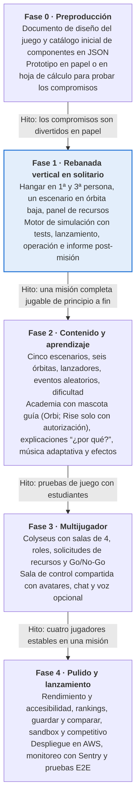

# Roadmap por fases

Cinco fases, cada una cerrada por un hito comprobable. La fase 1 es la clave: prueba que los compromisos de diseño son divertidos antes de invertir en multijugador. Las fases no tienen fechas porque aún no hay fecha de entrega (ver preguntas abiertas en `docs/GDD.md`).

| Fase | Documento | Hito de salida |
| --- | --- | --- |
| 0 · Preproducción | [fase-0.md](fase-0.md) | Los compromisos son divertidos en papel |
| 1 · Rebanada vertical en solitario | [fase-1.md](fase-1.md) | Una misión completa jugable de principio a fin |
| 2 · Contenido y aprendizaje | [fase-2.md](fase-2.md) | Pruebas de juego con estudiantes |
| 3 · Multijugador | [fase-3.md](fase-3.md) | Cuatro jugadores estables en una misión |
| 4 · Pulido y lanzamiento | [fase-4.md](fase-4.md) | Lanzamiento |

Estado actual de cada fase: ver la tabla de `CLAUDE.md` y `docs/STATUS.md`. Las casillas `- [ ]` de cada fase las marca quien valida la fase, no quien implementa.

Si el objetivo es un hackatón, la entrega mínima es la fase 1 más una sala cooperativa básica de la fase 3.
