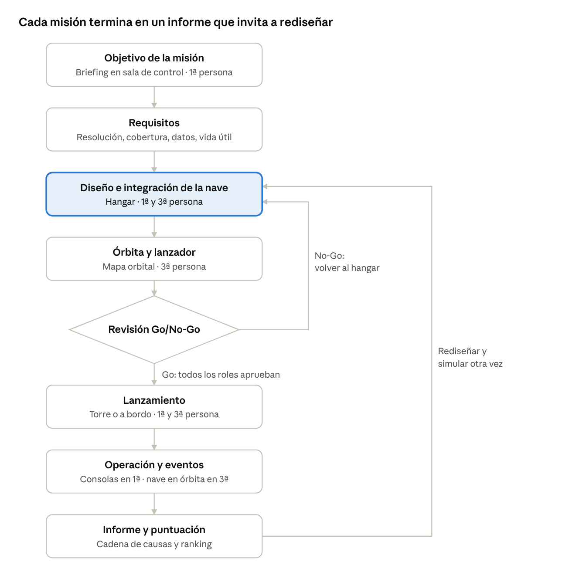
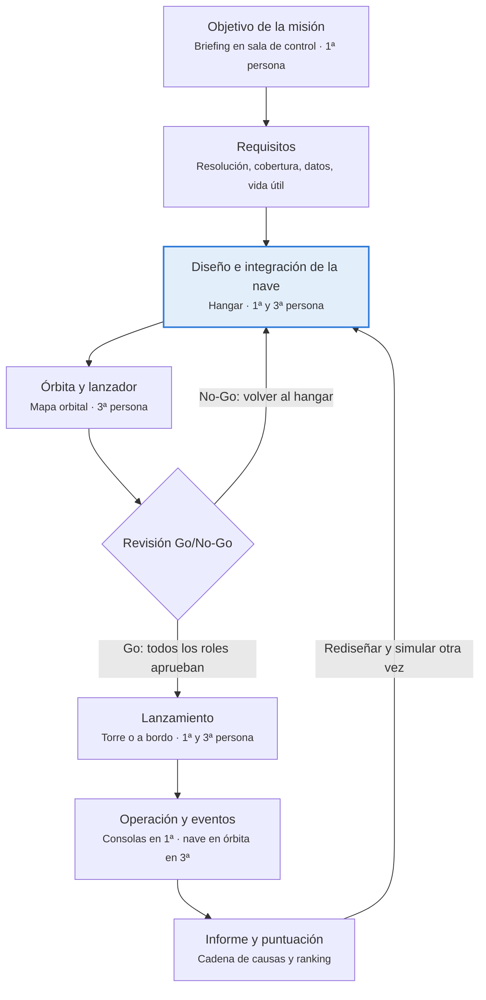
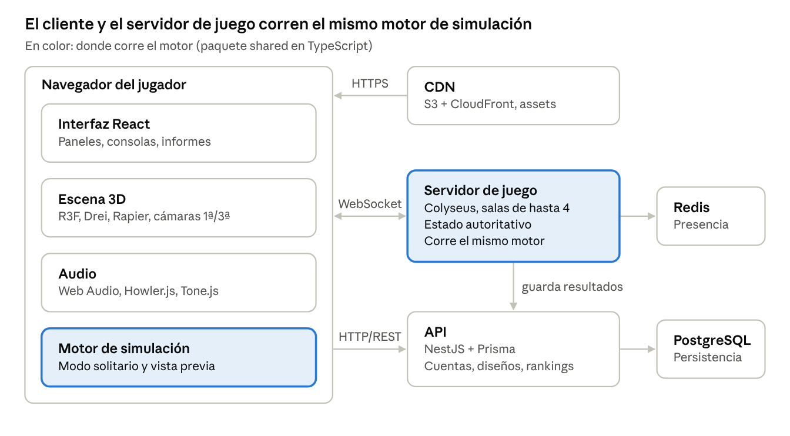
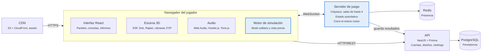
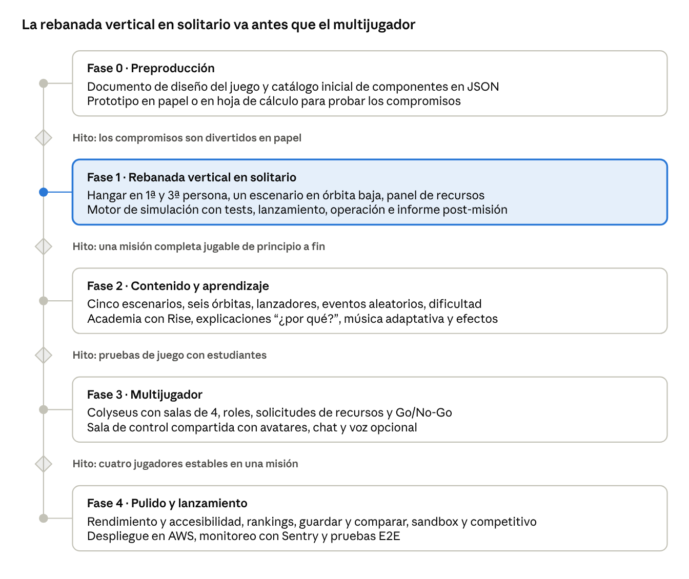
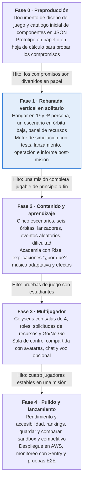

# Plan del juego web: Diseño de Misiones Espaciales

7 de noviembre de 2026 · Harry Hernández Arias

## Resumen

El juego es un simulador 3D web, en TypeScript con React Three Fiber, donde de 1 a 4 jugadores diseñan, lanzan y operan una misión espacial completa, alternando entre primera y tercera persona. El objetivo del reto es que los jugadores entiendan los compromisos reales del diseño de misiones: cada decisión sobre instrumentos, nave, órbita o lanzador mueve la masa, la energía, el presupuesto, los datos, las comunicaciones y la vida útil.

- **Regla 1 — web:** corre en el navegador sin instalar nada (Chrome, Edge, Firefox, Safari), con WebGL 2 como base y WebGPU como mejora opcional.
- **Regla 2 — primera y tercera persona tipo simulador:** el jugador camina por un hangar de integración y una sala de control (primera persona) y observa su nave y su órbita desde fuera (tercera persona). El cambio de cámara es una tecla.
- **Título de trabajo:** *Control de Misión* (provisional).

Público: estudiantes y aspirantes a ingenieros, desde nivel básico hasta avanzado, en español e inglés: el jugador elige el idioma al iniciar y puede cambiarlo en Ajustes en cualquier momento (español por defecto).

## Concepto y bucle de juego

Una partida recorre ocho etapas, y el informe final lleva de vuelta al diseño: el juego se aprende iterando, no acertando a la primera.



<details>
<summary>Código Mermaid editable</summary>



</details>

Un No-Go en la revisión regresa al hangar sin lanzar; el informe explica qué falló y por qué, y el jugador rediseña y vuelve a simular.

## Cámaras en primera y tercera persona

La primera persona se usa donde el jugador *hace* (montar, operar consolas); la tercera persona, donde *observa* (la nave completa, la órbita, a su equipo). Ambas comparten el mismo controlador de personaje, así que cambiar de vista no cambia la física.

| Espacio del juego | Primera persona | Tercera persona |
| --- | --- | --- |
| Hangar / sala limpia de integración | Caminar, tomar componentes de los estantes y encajarlos en puntos de montaje de la nave | Cámara sobre el hombro del avatar; vista libre alrededor de la nave para revisar el ensamble |
| Sala de control de misión | Sentarse en la consola del rol y usar pantallas interactivas (presupuesto, energía, enlaces) | Ver la sala completa y a los compañeros de equipo en sus consolas |
| Plataforma de lanzamiento | Vista desde la torre o a bordo durante la cuenta regresiva | Cámara de persecución del cohete, separación de etapas |
| Órbita / operación | Vista "a través del instrumento" para apuntar y capturar datos | Cámara orbital de la nave con la Tierra o el cuerpo objetivo; vista de mapa con la traza de la órbita |

**Controles**

- Teclado y ratón: WASD + ratón con *pointer lock*; `V` cambia primera/tercera persona; `E` interactuar; `Tab` panel de recursos.
- Mando (Gamepad API) y táctil como soporte secundario: joystick virtual y botón de cámara.
- Transición suave entre vistas (interpolación de 0.3–0.5 s) para no desorientar.

**Confort y accesibilidad**

- Deslizador de campo de visión, balanceo de cabeza desactivable y opción de girar por pasos para reducir mareo.
- Todo lo que se hace en primera persona también se puede hacer desde un panel 2D (modo accesible), para no excluir a quien no maneja controles 3D.

**Implementación**

- Controlador de personaje cinemático de Rapier (`@react-three/rapier`) para caminar y chocar con el hangar.
- Primera persona: `PointerLockControls` y `KeyboardControls` de Drei. Tercera persona: `CameraControls` de Drei con seguimiento amortiguado. Alternativa lista para usar: la librería *ecctrl* (controlador 1ª/3ª persona para R3F), a evaluar en el prototipo.

## Modos de juego y roles del equipo

Hay cinco modos y cuatro roles; con menos de cuatro jugadores los roles se combinan, y en solitario un asesor por rol (controlado por el juego) da recomendaciones.

| Modo | Jugadores | Qué aporta |
| --- | --- | --- |
| Academia (tutorial) | 1 | Rise, la mascota guía, enseña cada recurso con una mini-misión (CubeSat en órbita baja) |
| Campaña de escenarios | 1–4 | Misiones con objetivo, restricciones y dificultad crecientes |
| Cooperativo | 2–4 | Un equipo, una misión, cada quien con su rol y consola |
| Competitivo | 2+ equipos | Varios equipos resuelven el mismo objetivo; gana la mejor puntuación |
| Sandbox | 1–4 | Sin presupuesto ni límites predefinidos, para experimentar |

| Rol | Decide sobre | Recursos que vigila |
| --- | --- | --- |
| Director/a de misión | Objetivo, requisitos, órbita, lanzador, aprobación final | Presupuesto, tiempo de desarrollo |
| Ingeniería de nave | Estructura, paneles solares, baterías, computadora, control de actitud, térmico | Masa, energía |
| Ciencia y carga útil | Instrumentos científicos y plan de observación | Valor científico, datos generados |
| Operaciones y comunicaciones | Antenas, estaciones terrestres, ventanas de contacto, respuesta a eventos | Enlace de datos, vida útil |

**Mecánicas de colaboración**

- **Solicitudes de recursos:** si Ciencia quiere un instrumento que pide +40 W, Ingeniería debe aprobar o proponer otra solución; la solicitud queda visible para todos.
- **Presupuestos asignados:** el Director reparte el presupuesto por subsistema al inicio; reasignar requiere negociar.
- **Revisión Go/No-Go:** antes del lanzamiento cada rol vota; un No-Go obliga a explicar el motivo y volver a diseño.
- **Eventos en operación:** una falla (por ejemplo, una tormenta solar) exige que varios roles actúen a la vez desde sus consolas.
- **Comunicación:** chat de texto, marcadores (*pings*) sobre la nave y voz opcional por WebRTC.
- La puntuación final incluye una parte de colaboración (solicitudes resueltas, tiempo de respuesta a eventos).

## Mascota guía: Rise

Rise, la mascota lunar de Artemis II, guía la Academia y acompaña al jugador en todo el juego. Encaja con el propósito educativo: en la misión real fue el indicador de gravedad cero, y que flotara significaba que la nave había llegado a microgravedad.

**Quién es:** un peluche con forma de Luna sonriente y gorra azul y verde que evoca la foto *Earthrise* de Apollo 8. Lo diseñó Lucas Ye, un niño de California, para el concurso Moon Mascot de NASA y Freelancer, y la tripulación lo eligió entre más de 2,600 propuestas ([collectSPACE](https://www.collectspace.com/news/news-032726i-artemis-II-zero-g-indicator-rise-moon-mascot.html), [CBS News](https://www.cbsnews.com/news/zero-gravity-indicator-artemis-ii-8-year-old)).

| Momento del juego | Qué hace Rise |
| --- | --- |
| Academia (tutorial) | Presenta cada recurso con una mini-misión, lo explica en una o dos frases y señala en 3D el componente o la consola de la que habla |
| Hangar y sala de control | Flota junto al jugador como compañero, visible en 1ª y 3ª persona; con la tecla `H` da ayuda según lo que el jugador esté viendo |
| Panel de recursos | Muestra el “¿por qué?” de cada valor y cambia de expresión cuando un recurso entra en rojo |
| Lanzamiento | Hace de indicador de gravedad cero: queda quieto en la cabina y empieza a flotar al llegar a microgravedad, con una ficha que explica por qué |
| Informe post-misión | Narra la cadena de causas y sugiere qué rediseñar |
| Multijugador | Una sola Rise en la sala de control; sus avisos los ven todos los roles |

**Personalidad**

- Expresiones: contenta, pensativa, preocupada (recurso en riesgo) y celebrando (Go, misión exitosa).
- Frases cortas y amables; nunca dice solo “correcto” o “incorrecto”, explica por qué pasa algo.
- Voz y textos en español e inglés con subtítulos; los jugadores avanzados pueden dejarla solo en indicaciones o desactivarla.

**Implementación**

- Modelo 3D en GLB con textura de fieltro, *morph targets* para las expresiones y animaciones (flotar, saludar, señalar) reproducidas con `useAnimations` de Drei.
- Versión 2D para paneles y móviles (SVG o animación Rive/Lottie).
- Diálogos en JSON por idioma (i18next), disparados por eventos del motor de simulación; por ejemplo, `energia.margen_bajo` activa el aviso de batería.
- Sonidos propios: un “pop” al aparecer y tonos cortos por emoción.

**Derechos de uso: paso obligatorio antes de publicar**

- A diferencia de casi todo el material de NASA, el diseño de Rise no es de dominio público: NASA tiene los derechos y puede permitir reproducciones si se siguen sus guías de mercancía ([collectSPACE](https://www.collectspace.com/news/news-032726i-artemis-II-zero-g-indicator-rise-moon-mascot.html)).
- Acción: pedir autorización por escrito a NASA antes de publicar el juego o presentarlo en un concurso, y no sugerir que NASA respalda el juego. Esto no es asesoría legal; conviene confirmarlo con quien organice el reto.
- Plan B: si no hay autorización, el sistema de mascota funciona igual con una mascota original propia; se cambian el modelo, las animaciones y los diálogos sin tocar el código.

## Sistemas del juego

Todo el juego descansa en un motor de simulación en TypeScript puro, separado de los gráficos, que corre igual en el navegador (solitario) y en el servidor (multijugador). Los componentes, órbitas y lanzadores viven en archivos JSON, así que agregar contenido no requiere tocar código.

**1. Objetivo y requisitos de la misión**

- Tipos de misión: observación de la Tierra, telecomunicaciones, telescopio espacial, exploración lunar y exploración de Marte.
- Del objetivo salen requisitos medibles: resolución mínima, cobertura o revisita, volumen de datos al día, vida útil mínima.

**2. Nave y carga útil**

- Subsistemas: estructura, energía (paneles), baterías, comunicaciones, computadora de a bordo, control de actitud, térmico e instrumentos.
- Cada componente tiene: masa (kg), consumo (W), costo (millones de USD), tasa de datos (Mbit/día), valor científico, fiabilidad y nivel (simple o avanzado según dificultad).

**3. Órbita y lanzador**

- Órbitas: baja (LEO), heliosíncrona (SSO), media (MEO), geoestacionaria (GEO), muy elíptica (HEO) y transferencia lunar.
- Cada órbita cambia cobertura, revisita, fracción del tiempo en eclipse (afecta energía), minutos de contacto con estaciones terrestres, radiación y vida útil por arrastre.
- Cada lanzador tiene capacidad de carga por tipo de órbita, costo y fiabilidad. El juego valida que masa y órbita sean compatibles con el lanzador antes de permitir el Go.
- Modelo orbital simplificado (Kepler): el periodo sale de la altitud, y de ahí el eclipse y las ventanas de contacto:

$$
T = 2\pi \sqrt{\frac{a^{3}}{\mu}}, \qquad \mu_{\oplus} = 398\,600\ \text{km}^3/\text{s}^2
$$

**4. Recursos (presupuestos de ingeniería)**

- **Masa:** total vs capacidad del lanzador, con margen recomendado.
- **Energía:** generación en sol vs consumo; la batería debe cubrir el eclipse.
- **Presupuesto:** desarrollo + lanzamiento + operación.
- **Datos:** generados por los instrumentos.
- **Comunicaciones:** datos que se pueden bajar por día según antena y contactos; lo que no se baja se pierde.
- **Tiempo:** meses de desarrollo y vida operativa.
- Un panel en tiempo real muestra cada recurso como barra con margen y señala en rojo el que limita la misión.

**5. Simulación y eventos**

- Pasos de tiempo discretos con avance acelerado (1× a 10 000×) y pausa.
- Eventos aleatorios ponderados por dificultad: falla de rueda de reacción, tormenta solar, basura espacial, retraso de lanzamiento, recorte de presupuesto.
- Simulación determinista con semilla: la misma misión con la misma semilla da el mismo resultado, lo que permite comparar diseños de forma justa.

**6. Puntuación**

$$
S = w_1 \cdot \text{objetivos} + w_2 \cdot \text{ciencia} + w_3 \cdot \text{eficiencia} + w_4 \cdot \text{colaboración}
$$

- La eficiencia premia márgenes sanos (ni sobrado ni al límite). Los pesos w cambian por escenario.
- Rankings por escenario y opción de guardar, compartir por enlace y comparar diseños lado a lado.

**7. Valor educativo**

- Cada valor tiene un "¿por qué?" con una explicación de una o dos frases en lenguaje sencillo.
- Informe post-misión con la cadena de causas, por ejemplo: "la batería se agotó en el eclipse porque el instrumento térmico consume 60 W y la órbita pasa 35 min en sombra".
- Glosario y fichas opcionales presentadas por Rise (altitud orbital, carga útil, tasa de datos, enlace).

## Stack tecnológico

Lenguaje único: **TypeScript** en cliente y servidor, con un paquete compartido para tipos, catálogo y motor de simulación. El 3D va con **React Three Fiber sobre Three.js** y el multijugador con **Colyseus**; todo es código abierto y gratuito.

| Capa | Tecnología | Para qué |
| --- | --- | --- |
| Lenguaje | TypeScript | Un solo lenguaje y tipos compartidos entre cliente, servidor y simulación |
| Monorepo y build | pnpm workspaces + Turborepo, Vite | Paquetes `client`, `server`, `api`, `shared`; recarga rápida |
| Interfaz 2D | React 19, Tailwind CSS, componentes Radix/shadcn | Paneles de recursos, menús, informes |
| Motor 3D | [Three.js](https://www.utsubo.com/blog/threejs-2026-what-changed) + [React Three Fiber v9](https://r3f.docs.pmnd.rs/tutorials/v9-migration-guide) + Drei | Escenas declarativas en React; Drei aporta controles, carga de modelos y texto 3D |
| Renderizador | WebGL 2 de base; WebGPU opcional | R3F v9 admite WebGPU, aunque con [casos límite en post-procesado](https://www.utsubo.com/blog/webgpu-threejs-migration-guide); se activa cuando el prototipo lo justifique |
| Efectos | `@react-three/postprocessing` | Bloom de motores y pantallas, viñeta en primera persona |
| Física | [Rapier](https://gittrend.io/repo/pmndrs/react-three-rapier) (`@react-three/rapier`, WASM) | Colisiones del hangar, controlador de personaje, encaje de piezas |
| Mecánica orbital | Módulo propio de Kepler simplificado en `shared` | Periodo, eclipse, ventanas de contacto; probado con tests unitarios |
| Estado del cliente | Zustand | Estado de UI y de la escena |
| Flujo de fases | XState | Máquina de estados: briefing → diseño → Go/No-Go → lanzamiento → operación → informe |
| Multijugador | [Colyseus 0.18](https://tech-insider.org/colyseus-cloud-setup-2026/) + `@colyseus/sdk` | Salas de hasta 4, estado autoritativo sincronizado, emparejamiento y reconexión |
| Voz (opcional) | WebRTC (por ejemplo LiveKit) | Voz entre los integrantes del equipo |
| API | NestJS + Prisma | Cuentas, diseños guardados, rankings, informes |
| Base de datos | PostgreSQL; Redis | Persistencia; Redis para presencia y escalado de Colyseus |
| Autenticación | Modo invitado + OAuth (Google/GitHub) | Jugar sin registro; registrarse para guardar y rankear |
| Idiomas | i18next | Selector español/inglés desde la primera versión; textos de interfaz, tutoriales, glosario y subtítulos en ambos idiomas, con el idioma guardado en el perfil |
| Pruebas | Vitest, Playwright | Simulación con tests unitarios; flujo completo con E2E |
| Errores y métricas | Sentry | Errores de WebGL/WebGPU y rendimiento por dispositivo |
| Despliegue | AWS: S3 + CloudFront (cliente y assets), ECS Fargate (Colyseus y API), RDS PostgreSQL, ElastiCache Redis | Alternativa gestionada para el servidor de juego: Colyseus Cloud |

Alternativa de motor considerada: **Babylon.js** (motor más completo, con editor y audio integrados). Se prefiere R3F porque permite mezclar la interfaz React de paneles con la escena 3D y encaja con un equipo que ya trabaja en React.

## Audio: música, efectos y voces

El audio usa la Web Audio API del navegador: sonido 3D posicional con `PositionalAudio` de Three.js dentro del hangar y la sala de control, y Howler.js para música y sonidos de interfaz. La música es adaptativa: cambia de capa según la fase de la misión.

| Tipo | Ejemplos en el juego | Herramienta o fuente |
| --- | --- | --- |
| Música adaptativa | Diseño: ambiente tranquilo · Lanzamiento: crescendo de percusión · Operación: ambiente espacial · Crisis: tensión · Éxito/fracaso: remates cortos | Pistas en capas (*stems*) que se mezclan con fundidos; composición propia o música libre de regalías con licencia comercial verificada |
| Efectos de interfaz | Clic, encajar componente, error de validación, barra de recurso en rojo | Tone.js o jsfxr para sintetizarlos; Freesound (filtrar por CC0) |
| Efectos del mundo 3D | Pasos, puertas del hangar, herramientas, motores, separación de etapas, alarmas, pitidos de telemetría, estática de radio | Biblioteca de audio de NASA y [Artemis Audio](https://www.nasa.gov/artemisaudio); Freesound CC0 |
| Voces | Cuenta regresiva, comunicaciones tipo CAPCOM, avisos del asesor, voz de Rise en el tutorial | Grabaciones de NASA para lanzamientos reales; voz original en español e inglés con actores o TTS con licencia comercial, que sigue el idioma elegido |
| Ambientes | Zumbido del hangar, murmullo de la sala de control, interior de la nave | Grabaciones propias o CC0, en bucle |

**Decisiones de diseño sonoro**

- **Realismo educativo:** en el vacío no hay sonido. En tercera persona exterior se oye un ambiente amortiguado y los sonidos "de interior" de la nave, y el tutorial lo explica.
- **Audio NASA:** NASA permite reutilizar sus grabaciones sin pedir permiso siempre que se sigan sus [guías de uso](https://www.nasa.gov/artemisaudio) y no se sugiera que NASA respalda el juego.
- **Formatos:** Opus/WebM con respaldo AAC (.m4a); efectos cortos agrupados en *sprites* de audio para cargar menos archivos.
- **Mezcla:** volumen normalizado entre pistas (alrededor de −16 LUFS para web) y canales separados de música, efectos y voz.
- **Accesibilidad:** subtítulos para toda voz y una señal visual para cada alarma.
- **Herramientas de edición:** Audacity o Reaper para cortar, limpiar y normalizar.

## Arte y assets 3D

Estilo recomendado: realista simplificado (*low-poly* limpio con buena iluminación), que se ve bien en laptops modestas y deja leer cada componente. Formato único de modelos: **glTF/GLB** comprimido.

| Recurso | Fuente o herramienta | Nota |
| --- | --- | --- |
| Naves, sondas, cohetes, estaciones | [NASA 3D Resources](https://github.com/nasa/NASA-3D-Resources) | Sin copyright; existe una [versión repaquetada en GLB](https://huggingface.co/datasets/codepawl/nasa-3d-glb) con LOD y colisiones listas para Rapier. Las insignias y logotipos de NASA no se pueden usar |
| Componentes modulares (paneles, antenas, cajas de instrumentos) | Modelado propio en Blender | Piezas con puntos de encaje (*sockets*) definidos para el hangar |
| Hangar y sala de control | Blender + kits CC0 (por ejemplo, Kenney) | Interiores modulares reutilizables |
| Tierra, Luna y Marte | Texturas públicas de NASA (Blue Marble y similares) | Esfera con mapa de color, nubes y luces nocturnas |
| Iluminación | HDRI de Poly Haven (CC0) | Reflejos realistas en el metal de la nave |
| Interfaz | Pantallas diegéticas con `Html` de Drei o render a textura; iconos Lucide | Las consolas 3D muestran la misma UI que los paneles 2D |
| Tipografía | Space Grotesk, Inter, JetBrains Mono (licencia OFL) | Estilo de consola de control |

**Optimización de assets**

- Geometría comprimida con Meshopt o Draco y texturas en KTX2 (gltf-transform en la tubería de build).
- Niveles de detalle (LOD) e *instancing* para piezas repetidas; carga por escena con `Suspense` y pantalla de carga.

## Arquitectura y estructura del proyecto

El motor de simulación vive en un paquete compartido: en solitario corre en el navegador y en multijugador lo corre el servidor de juego, que es la única fuente de verdad del estado.



<details>
<summary>Código Mermaid editable</summary>



</details>

Los clientes solo envían acciones ("agregar instrumento", "votar Go"); Colyseus las valida, recalcula los presupuestos y sincroniza el estado con todo el equipo.

```text
control-de-mision/
├─ apps/
│  ├─ client/        # React + R3F + Vite (escenas, UI, audio)
│  ├─ game-server/   # Colyseus (salas, roles, Go/No-Go)
│  └─ api/           # NestJS + Prisma (cuentas, diseños, rankings)
├─ packages/
│  └─ shared/        # tipos, motor de simulación, mecánica orbital
│     └─ catalog/    # componentes.json, orbitas.json, lanzadores.json, escenarios.json
└─ assets/           # modelos .glb, texturas .ktx2, audio .webm/.m4a
```

## Roadmap por fases

Cinco fases, cada una cerrada por un hito comprobable; la fase 1 es la clave, porque prueba que los compromisos de diseño son divertidos antes de invertir en multijugador.



<details>
<summary>Código Mermaid editable</summary>



</details>

Las fases no tienen fechas porque aún no hay fecha de entrega; si es para un hackatón, la entrega mínima es la fase 1 más una sala cooperativa básica de la fase 3.

## Riesgos y cobertura de los requerimientos

El mayor riesgo es el alcance: el 3D en primera/tercera persona y el multijugador pueden comerse el tiempo del núcleo, que es la simulación de compromisos. Por eso el plan construye primero la simulación jugable en solitario.

| Riesgo | Mitigación |
| --- | --- |
| Alcance demasiado grande | Rebanada vertical primero (1 escenario completo); multijugador y modos extra después |
| Rendimiento en laptops y móviles | WebGL 2 de base, LOD, texturas KTX2, ajuste de calidad automático y meta de 60 FPS en una laptop de gama media |
| Mareo en primera persona | Campo de visión ajustable, sin balanceo, modo de panel 2D |
| Desincronización en multijugador | Servidor autoritativo (Colyseus) que corre el mismo motor de simulación; clientes solo envían acciones |
| Realismo vs diversión | Modelos simplificados con valores plausibles; pruebas de juego con estudiantes en cada fase |
| Licencias de assets y audio | Solo CC0, dominio público o licencia comercial verificada; registro de fuentes en el repositorio |

**Cobertura del documento de requerimientos**

| Requerimiento | Cómo lo cubre el plan |
| --- | --- |
| Diseñar y gestionar una misión completa | Bucle briefing → diseño → lanzamiento → operación → informe |
| Individual o equipos de hasta 4 | Modos solitario (con asesores), cooperativo y competitivo |
| Roles y negociación | Cuatro roles, solicitudes de recursos y revisión Go/No-Go |
| Nave, instrumentos, lanzador y órbita | Catálogo de componentes, 6 órbitas, validación masa/órbita/lanzador |
| Masa, energía, presupuesto, datos, comunicaciones, tiempo | Panel de recursos en tiempo real con márgenes |
| Consecuencia de cada decisión y varias soluciones válidas | Motor de presupuestos encadenados; puntuación por márgenes, no por una respuesta única |
| Simular varias veces | Simulación con semilla y avance acelerado; rediseñar y repetir |
| Puntuación, rankings, informe post-misión | Fórmula ponderada, rankings por escenario, informe con cadena de causas |
| Dificultad, escenarios, eventos aleatorios, sandbox | Campaña por niveles, eventos ponderados, modo sandbox |
| Valor educativo accesible | Academia, "¿por qué?" en cada valor, glosario |
| Guardar, compartir y comparar diseños | API + PostgreSQL, enlace compartible, comparador |

**Preguntas abiertas**

- ¿Hay fecha de entrega o es para un hackatón con jurado? Define cuánto del roadmap entra en la primera entrega.
- ¿Cuántas personas desarrollan y quién cubre arte 3D y audio?
- ¿Debe funcionar en móviles o basta con escritorio?

## Fuentes

- [Guía de migración a R3F v9](https://r3f.docs.pmnd.rs/tutorials/v9-migration-guide)
- [Three.js en 2026: WebGPU y cambios recientes](https://www.utsubo.com/blog/threejs-2026-what-changed)
- [Guía de migración WebGL → WebGPU con Three.js y R3F](https://www.utsubo.com/blog/webgpu-threejs-migration-guide)
- [react-three-rapier](https://gittrend.io/repo/pmndrs/react-three-rapier)
- [Colyseus 0.18 y Colyseus Cloud](https://tech-insider.org/colyseus-cloud-setup-2026/)
- [NASA 3D Resources](https://github.com/nasa/NASA-3D-Resources) · [versión GLB repaquetada](https://huggingface.co/datasets/codepawl/nasa-3d-glb)
- [NASA Artemis Audio](https://www.nasa.gov/artemisaudio)
- Documento de requerimientos del reto (archivo adjunto)
